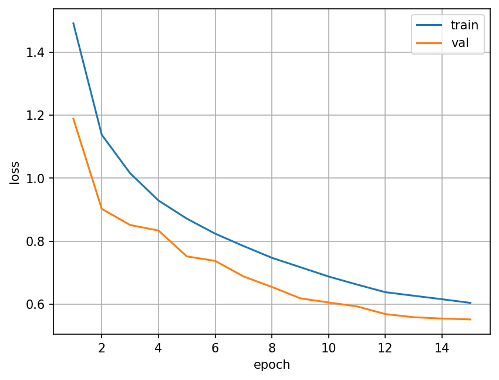
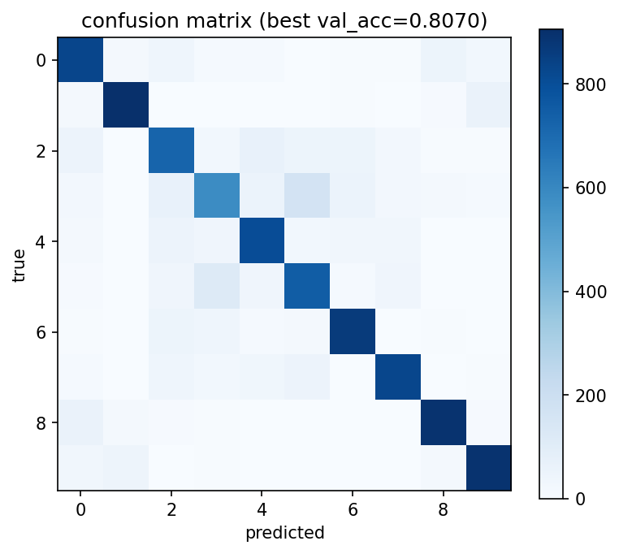

# 端侧 AI 实战项目：CIFAR-10 训练 → ONNX → RKNN → INT8 量化

> 一个完整的**端侧 AI 闭环 Demo**：PyTorch 训练 → 导出 ONNX → 转 RKNN → INT8 量化 → 精度对比。
> 目标硬件：**RK3588（Rockchip NPU）**　｜　开发环境：WSL2 Ubuntu 22.04 + RTX 4060 Laptop


---

## ✨ 项目亮点

| 能力 | 结果 |
|---|---|
| 训练 | CIFAR-10 小 CNN，验证集准确率 **81.2%** |
| 导出 | PyTorch → ONNX，与原始输出误差 < 1e-6 |
| 转换 | ONNX → RKNN（FP16），模拟器与 PyTorch 预测一致 |
| 量化 | INT8 量化后准确率 **81.4%**，精度无损 |
| 压缩 | 模型体积 **2.4 MB → 668 KB**（约 3.6×） |

---

## 📊 量化对比结果

| 模型 | 精度 | 文件大小 | 相对体积 |
|---|---:|---:|---:|
| FP32（PyTorch） | 81.20% | 2.4 MB | 1.00× |
| FP16（RKNN） | ≈ 81.2% | 1.3 MB | 0.54× |
| **INT8（RKNN）** | **81.40%** | **668 KB** | **0.28×** |

> **评估设置**：CIFAR-10 测试集 500 张；校准集 50 张（`data/calib`）。
> **结论**：INT8 量化精度无损（-0.2% 属统计噪声），体积缩小约 3.6 倍，适合部署到 RK3588 NPU。

---

## 📁 目录结构

```text
edge-ai-project/
│
├── src/                        # 【训练侧】模型定义与训练代码
│   ├── train.py                #   CIFAR-10 训练脚本：定义 SmallCNN、训练循环、保存 best.pth、画 loss 曲线与混淆矩阵
│   └── Quickstart.py           #   跟随 PyTorch 官方 Quickstart 的学习脚本（FashionMNIST，仅学习用）
│
├── deploy/                     # 【部署侧】模型导出、转换、量化、验证
│   ├── export_onnx.py          #   best.pth → model.onnx，并用 onnxruntime 与 PyTorch 输出对比验证
│   ├── convert_rknn.py         #   model.onnx → model_int8.rknn（含 INT8 量化，指定 RK3588 平台）
│   ├── verify_rknn.py          #   模拟器验证：FP16 RKNN 的推理结果与 PyTorch 是否一致
│   ├── make_calib.py           #   生成 INT8 校准集：从 CIFAR 测试集存 50 张图并写 calib.txt
│   ├── eval_int8.py            #   INT8 精度评估：对比 FP32(PyTorch) 与 INT8(RKNN) 在测试集上的准确率
│   ├── model.onnx              #   导出的 ONNX 模型（产物，不提交 Git）
│   ├── model.rknn              #   FP16 RKNN 模型（产物，不提交 Git）
│   └── model_int8.rknn         #   INT8 量化 RKNN 模型（产物，不提交 Git）
│
├── data/                       # 【数据集】不提交 Git
│   ├── cifar-10-batches-py/    #   CIFAR-10 原始数据（自动下载）
│   └── calib/                  #   量化校准集：50 张 png + calib.txt
│
├── reports/                    # 【实验产出】训练与评估的可视化结果
│   ├── loss_curve.png          #   训练/验证 loss 曲线
│   ├── confusion_matrix.png    #   验证集混淆矩阵
│   └── quant_report.md         #   量化对比报告（精度 / 大小）
│
├── configs/                    # 【预留】训练配置文件（yaml/json）
├── tests/                      # 【预留】单元测试与一致性测试
│
├── best.pth                    # 训练得到的最佳权重（产物，不提交 Git）
├── requirements.txt            # Python 依赖清单
├── .gitignore                  # 忽略数据、模型权重、虚拟环境等
└── README.md                   # 本文件
```

---

## 🧰 环境版本

| 项目 | 版本 |
|---|---|
| 系统 | Ubuntu 22.04（WSL2） |
| Python | 3.10.12 |
| PyTorch | 2.4.1+cu121 |
| torchvision | 0.19.1+cu121 |
| CUDA runtime | 12.1 |
| 显卡驱动支持的 CUDA | 12.2 |
| RKNN-Toolkit2 | 2.5.0 |
| GPU | RTX 4060 Laptop（8GB） |
| 目标平台 | RK3588（NPU，6 TOPS） |

---

## 🚀 快速开始

### 1. 训练

```bash
python src/train.py --epochs 15
# 产物：best.pth、reports/loss_curve.png、reports/confusion_matrix.png
```

### 2. 导出 ONNX 并验证

```bash
python deploy/export_onnx.py
# 产物：deploy/model.onnx，并打印 torch vs onnx 的最大误差
```

### 3. 生成校准集 + 转 RKNN（INT8）

```bash
python deploy/make_calib.py      # 生成 data/calib/（50 张图 + calib.txt）
python deploy/convert_rknn.py    # 产物：deploy/model_int8.rknn
```

### 4. 评估量化精度

```bash
python deploy/eval_int8.py
# 输出：torch FP32 acc / rknn INT8 acc / drop
```

> 说明：PC 上的 RKNN 推理走**模拟器**（`init_runtime()` 不带 target），不需要开发板。
> 真机部署需要 RK3588，届时用 `load_rknn` + `init_runtime(target='rk3588')`。

---

## 📈 训练结果





---

## 🗺️ 路线图

- [x] CIFAR-10 训练（81.2%）
- [x] 导出 ONNX 并验证数值一致
- [x] ONNX → RKNN 转换（RK3588）
- [x] INT8 量化 + 精度对比（无损，3.6× 压缩）
- [ ] 上板部署：真实 FPS / 内存 / 功耗测试（需 RK3588）
- [ ] 模型压缩进阶：知识蒸馏 / 结构化剪枝 / QAT
- [ ] 摄像头实时推理 Demo

---

## 📄 License

仅用于学习与技术验证。
